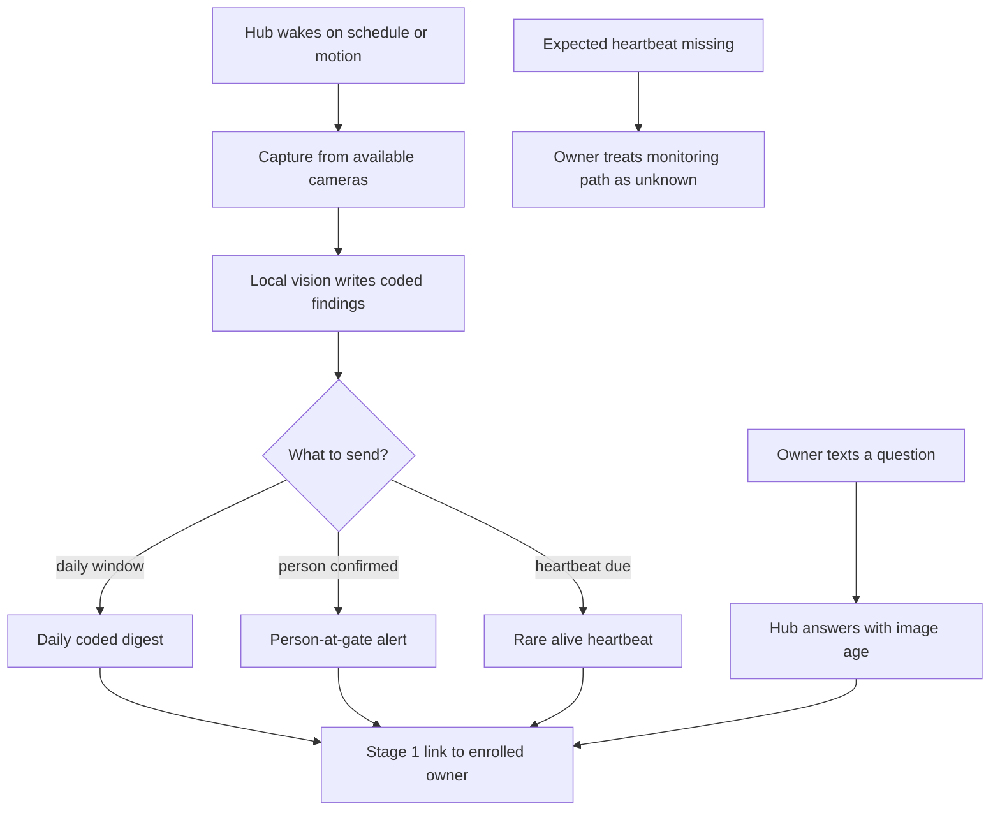

# Plot Guardian Stage 2 Eyes and Local AI - Plan

## Goal Capsule

- **Objective:** A city owner of a countryside vegetable plot can rely on short text reports about beds and the gate without driving out, including when the public internet is down.
- **Means:** An on-plot hub runs local vision, sends a daily coded digest, rare heartbeats, and person-at-gate alerts, and answers text questions from the latest images over Stage 1's low-connectivity link.
- **Product authority:** This plan owns Plot Guardian Stage 2 (eyes and local AI) only. Stage 1 (water and link) and Stage 3 (robot gantry) are surrounding areas, not active scope.
- **Open blockers:** None. Remaining items are deferred to planning.

---

## Product Contract

### Summary

Plot Guardian Stage 2 is an on-plot hub that watches beds and the gate with local vision and texts the enrolled city owner a short daily coded digest, rare "still alive" heartbeats, and person-at-gate alerts. The owner can text a question and get an answer drawn from the latest on-plot images, with capture age disclosed. Messages ride Stage 1's low-connectivity channels so they still work when the public internet fails, including war or calamity outages. At least one local-network camera is required so vision survives those outages.

### Problem Frame

Romanian owners of vegetable plots 50–100 km from the city already drive out, pay someone on site, or install cameras. Those options still fail together: false alarms, no signal to review a live feed from the city, and no time to watch video. In war or calamity, public connectivity is worse, so a product that depends on pulling images to the phone is the wrong bet. The owner needs short, trustworthy text that arrives when the network is thin, without treating a silent monitoring path as "all clear."

### Key Decisions

- **Stage 2 only.** (session-settled: user-directed — chosen over Stage 1, Stage 3, or Stages 1+2: each stage is independently useful; this run owns eyes and local AI.) Surrounding stages stay context, not requirements. Governs product authority in Goal Capsule; Scope Boundaries.
- **Guardian digest plus rare heartbeat.** (session-settled: user-directed — chosen over Quiet sentinel or Twin audience: matches daily summary + gate alert + Q&A success bar while avoiding silence-as-OK.) Governs R3, R4, R5.
- **Proactive reports and text Q&A in the first ship.** (session-settled: user-directed — chosen over reports-only: first useful Stage 2 includes answering questions about what the hub saw.) Governs R6.
- **Soft image rule.** (session-settled: user-directed — chosen over strict on-plot-only or split plant/security camera rules: prefer local capture; vendor/cloud cameras allowed when the internet works, knowing some frames may already sit with the vendor.) Governs R9, R10. Local-network camera required for outage duty; Stage 2 must not upload hub-managed local frames off-plot.
- **Missed heartbeat means monitoring trouble.** Confirmed in synthesis and refined in review: absence of an expected heartbeat means the monitoring path is unreliable (hub or Stage 1 link) and plot status is unknown — not all-clear and not automatic plot emergency. Governs R5, AE4.
- **Beds and gate in the first ship.** Confirmed in synthesis: horticulture status and person-at-gate events both ship together, not phased. Governs R2, R3, R4.
- **Trustworthy short text over raw detections.** Review: person-at-gate uses a confirmation policy; digests and Q&A mark uncertain claims; expected-visitor quieting avoids caretaker cry-wolf. Governs R4, R7, R8.

<!-- ce-section: work-relationships -->
### How This Work Fits Together

This plan covers **Stage 2 — Eyes and local AI** only. The broader Plot Guardian breakdown below is the current understanding, not a committed roadmap.

- **Stage 1 — Water and link**
  - **Enables** Stage 2: compact multi-channel messaging (mobile SMS/low-power data, LoRa relays, later amateur shortwave) and the physical plot context.
  - **Can proceed independently of** Stage 2.
- **Stage 2 — Eyes and local AI** (this plan)
  - **Depends on** Stage 1's link for outbound reports and inbound questions.
  - **Can proceed independently of** Stage 3.
- **Stage 3 — Robot gantry** (optional)
  - **Can proceed independently of** Stage 2 for mechanical work; imaging may later **Share** on-plot vision with Stage 2.
  - Still to decide in a later plan: how much Stage 2 report vocabulary Stage 3 reuses.

### Actors

- A1. **Owner** — city-based owner of a countryside vegetable plot, enrolled as the sole Stage 2 message party, who receives texts and may send questions.
- A2. **On-plot hub** — Stage 2 computer that wakes on a schedule or on motion, runs local vision, and exchanges short messages via the Stage 1 link.
- A3. **Cameras** — at least one local-network camera required for outage vision; vendor/cloud cameras optional when the public internet reaches the plot.
- A4. **Stage 1 link** — multi-channel messaging path assumed available; not built in this plan.

### Key Flows

- F1. Daily coded digest
  - **Trigger:** Scheduled wake in the daily reporting window.
  - **Actors:** A2, A3, A4, A1
  - **Steps:** Hub captures; local vision encodes bed and notable findings; claims the pipeline cannot support are marked uncertain; hub sends one short coded digest over Stage 1 to the enrolled owner.
  - **Outcome:** Owner receives a compact plot status text without opening a video feed.
  - **Covered by:** R2, R3, R7, R11, R13

- F2. Person-at-gate alert
  - **Trigger:** Motion or vision detects a person at the gate (or equivalent watched entry) outside any expected-visitor / quiet window.
  - **Actors:** A2, A3, A4, A1
  - **Steps:** Hub wakes if needed; applies the confirmation / confidence policy; if it passes and is not quieted, sends a short alert with time to the enrolled owner.
  - **Outcome:** Owner learns of unexpected entry events without live video, without cry-wolf paging for routine caretakers.
  - **Covered by:** R4, R8, R11, R13

- F3. Rare heartbeat
  - **Trigger:** Heartbeat interval elapses with hub healthy.
  - **Actors:** A2, A4, A1
  - **Steps:** Hub sends a short alive / last-seen line to the enrolled owner. If an expected heartbeat does not arrive, the owner treats plot status as unknown because the monitoring path failed — not as all-clear and not as automatic plot emergency.
  - **Outcome:** Silence is not mistaken for safety; link blips are not mistaken for plot crisis.
  - **Covered by:** R5, AE4

- F4. Owner Q&A
  - **Trigger:** Enrolled owner texts a question about the plot.
  - **Actors:** A1, A4, A2, A3
  - **Steps:** Stage 1 delivers a question attributable to enrollment; hub uses images within the stale threshold or captures fresh ones; answer includes capture age / last-seen time and marks unsupported claims uncertain; answer returns as short text. Images are not sent to the owner.
  - **Outcome:** Owner can ask what the hub saw without pulling a feed or trusting silent stale frames.
  - **Covered by:** R6, R7, R10, R11, R13

### Requirements

**Reporting and awareness**

- R1. The Stage 2 hub operates on the plot and produces owner-facing value without a cloud vision service as its primary path.
- R2. Local vision covers vegetable beds (condition such as wilting and weeds) and at least one watched entry (gate / person).
- R3. The hub sends the enrolled owner a short daily coded digest of bed status and notable findings.
- R4. The hub sends a short person-at-gate (or equivalent entry) alert when that event is detected and passes a product-defined confirmation / confidence policy that prevents recreating the false-alarm failure mode named in Problem Frame; the alert includes time. Exact thresholds are deferred to planning.
- R5. The hub sends rare alive heartbeats on a longer interval than the daily digest; missing an expected heartbeat means the monitoring path is unreliable (hub or Stage 1 link) and plot status is unknown — not an all-clear and not an automatic plot emergency. Owner-facing meaning must say that.
- R6. The enrolled owner can text a question and receive a short-text answer derived from on-plot images. Every answer includes the capture age or last-seen time of the images used. When those frames are older than a product-defined stale threshold, the hub captures fresh images before answering. Exact threshold deferred to planning.
- R7. Digests and Q&A only assert bed or gate claims the local vision pipeline can support; they emit uncertain / unknown when confidence is low.
- R8. The owner can define expected-visitor or quiet windows (or equivalent) so routine caretaker or neighbor presence is not paged as an unexpected person-at-gate. Exact UX deferred to planning. Twin audience (second recipient) stays deferred.

**Cameras, privacy, and link**

- R9. A Stage 2 install must include at least one plot-local-network camera that can serve vision when public internet is down. When the public internet is down, the hub continues vision from those local-network cameras.
- R10. When the public internet works, the hub may also use vendor/cloud cameras as optional additives; they are never a sufficient sole source for R9 / R12 duties. Local capture remains preferred. Stage 2 must not upload or forward hub-managed local-network camera frames off-plot. Any off-plot frames vendor cameras already hold are vendor behavior Stage 2 acknowledges, not a path Stage 2 may open for local capture.
- R11. All owner-facing Stage 2 messages use Stage 1's compact multi-channel link so short texts still leave the plot when internet and high bandwidth are unavailable.
- R12. Stage 2 remains useful under public-network failure (including war or calamity conditions), not only under ordinary weak rural internet — which requires the local-network camera in R9 and Stage 1 messaging in R11.
- R13. Stage 2 binds outbound digests, person-at-gate alerts, and heartbeats, and inbound Q&A, to the enrolled owner channel(s). The hub answers only questions attributable to that enrollment (via Stage 1 identity guarantees or an equivalent Stage 2 enrollment when Stage 1 is an opaque pipe).
- R14. Owner-facing answers and reports do not transmit plot images to the city; only coded or short natural-language text leaves via the link.

### Acceptance Examples

- AE1. Daily digest
  - **Covers:** R3, R7, R11
  - **Given:** Hub and Stage 1 link are up; morning report window arrives.
  - **When:** The hub completes its scheduled vision pass.
  - **Then:** The enrolled owner receives one short coded text summarizing beds and notable findings, with unsupported claims marked uncertain, and with no image attachment.

- AE2. Person at gate
  - **Covers:** R4, R8
  - **Given:** A person appears at the watched gate outside any quiet window, and detection passes the confirmation policy.
  - **When:** The hub processes the event.
  - **Then:** The enrolled owner receives a short alert that names the gate event and time.

- AE3. Q&A without images
  - **Covers:** R6, R7, R14
  - **Given:** Images on the hub are within the stale threshold (or the hub can capture fresh ones).
  - **When:** The enrolled owner texts a question such as whether bed 2 looks wilted.
  - **Then:** The owner receives a short-text answer that includes capture age / last-seen time; no image is sent to the city.

- AE4. Missed heartbeat
  - **Covers:** R5
  - **Given:** A heartbeat was expected and none arrives within the grace the product defines.
  - **When:** The owner notices the gap.
  - **Then:** The situation is treated as monitoring-path unreliable and plot status unknown — not as an all-clear plot and not as automatic plot emergency.

- AE5. Internet outage, local cameras remain
  - **Covers:** R9, R11, R12
  - **Given:** Public internet to the plot is down; the required local-network camera still works; Stage 1 link still delivers short messages.
  - **When:** The daily window or a gate event occurs.
  - **Then:** The enrolled owner still receives the corresponding short text sourced from local cameras.

- AE6. Vendor camera only while net is up
  - **Covers:** R9, R10
  - **Given:** A vendor/cloud camera is configured alongside the required local camera, and the public internet later drops.
  - **When:** The hub needs images during the outage.
  - **Then:** The hub does not depend on that vendor camera; it uses the local-network camera for Stage 2 duties.

- AE7. Expected visitor quieted
  - **Covers:** R8
  - **Given:** The owner has defined a quiet window covering a caretaker visit.
  - **When:** The caretaker appears at the gate during that window.
  - **Then:** The hub does not send an unexpected person-at-gate alert for that presence.

- AE8. Non-owner question ignored
  - **Covers:** R13
  - **Given:** A short text question arrives that is not attributable to the enrolled owner.
  - **When:** The hub would otherwise answer Q&A.
  - **Then:** The hub does not return plot status to that sender.

### Success Criteria

- After a week of use, the enrolled owner can skip a routine drive because daily digests, person-at-gate alerts, and Q&A about what the hub saw are trustworthy enough in short text (including age-marked answers and controlled false alarms).
- During a public-network outage that still allows Stage 1 messaging, the owner continues to receive digests/alerts/Q&A from the required local-network camera.
- A missed heartbeat is understood as monitoring-path risk and unknown plot status, not reassurance about the plot and not automatic plot emergency.

### Scope Boundaries

**Deferred for later**

- Neighbor or caretaker as a second recipient of security alerts (Twin audience).
- Quiet event-only mode without a daily digest.
- Strict ban on any vendor/cloud camera.
- Live video to the owner's phone as the primary experience.
- Stage 3 robot gantry seeding, weeding, and gantry imaging product work.
- Explicit proactive "heartbeat missing" push notifications beyond the owner noticing the gap.

**Outside this product's identity**

- Replacing Stage 1 water hardware or inventing the multi-channel link inside Stage 2.
- Becoming a general neighborhood security network.
- Depending on cloud vision or FarmBot cloud image upload as the primary Stage 2 path (this repo's FarmBot web app stores webcam URLs and GCS-backed device photos for a different product model).

### Dependencies / Assumptions

- Stage 1 link exists or will exist soon enough to carry compact inbound and outbound messages (SMS / low-power data, LoRa relay chain, later amateur shortwave as channels evolve).
- Stage 2 requires from Stage 1 either sender/recipient authenticity sufficient for enrolled-owner binding (R13), or an opaque pipe plus Stage 2's own enrollment mechanism.
- The plot has power for the hub and at least one local-network camera when internet is down.
- Coded report vocabulary can be compact enough for Stage 1 message size limits.
- Verified contrast in this repository: no Plot Guardian product exists today; FarmBot webcam feeds are external URLs rendered in the browser; device photos use GCS; weed detection / `take_photo` are device camera ops; cloud OpenAI here assists Lua/sequences, not on-plot offline vision reporting.

### Outstanding Questions

**Resolve Before Planning**

- None.

**Deferred to Planning**

- Exact coded digest field set and encoding (beyond examples like wilting / weeds / person time).
- Heartbeat interval and grace period before "missed."
- Person-at-gate confirmation / confidence thresholds and uncertain-label wording.
- Q&A image stale threshold and capture-on-question power budget.
- Expected-visitor / quiet-window UX and how schedules reach the hub over Stage 1.
- How vendor/cloud camera adapters are selected and authenticated when the net is up.
- Hub wake policy details (motion vs few-times-daily power budget).
- On-hub retention TTL for hub-managed frames that include person imagery.
- Whether any FarmBot on-device camera/plant-detection pieces are reused as optional Stage 3 adjacency later, without pulling Stage 2 onto the FarmBot cloud path.

### Sources / Research

- Dialogue settled Stage 2 scope, Guardian digest + rare heartbeat, soft image rule, and calamity-oriented durability.
- Repo grounding dossier (scratch): confirms FarmBot cloud webcam / GCS / device photo / OpenAI-Lua patterns as contrast, not Stage 2 precursors — see claim verification against `app/models/webcam_feed.rb`, `frontend/controls/webcam/webcam_img.tsx`, `app/models/image.rb`, `frontend/photos/actions.ts`, `frontend/devices/actions.ts`, `app/controllers/api/ais_controller.rb`.
- Document review (2026-11-15): applied entailed and proposed fixes for local-camera must-have, false-alarm / confidence policy, expected-visitor quieting, owner-channel binding, no local-frame off-plot upload, Q&A freshness, and monitoring-path heartbeat meaning.
